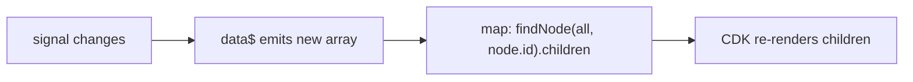

# NestedTree1 — signal-driven rendering notes

`NestedTree1` renders an Angular Material nested tree (`mat-tree`) whose data is
driven by a **signal** bound through the `data` input:

```html
<lib-nested-tree1 [data]="service.treeDataSignal()" ...></lib-nested-tree1>
```

The service signal is the single source of truth; the parent never calls an
imperative `setData()`. This document explains the non-obvious parts of that
wiring and the two bugs it originally introduced.

---

## 1. Signals, `effect`, and the glue to MatTree

A **signal** is a reactive value holder. Angular remembers every place a signal
is *read* (in a template or inside an `effect`) and re-runs that code when the
signal changes.

MatTree's `MatTreeNestedDataSource`, however, is an older imperative API — it
does **not** understand signals. The `effect` in the constructor is the bridge:

```ts
constructor() {
  effect(() => {
    const newData = this.data();        // READ a signal -> registers a dependency
    this.dataSource.data = newData;      // push it into MatTree's (non-signal) data source
    if (!this.seeded && newData.length) {
      this.seeded = true;
      setTimeout(() => this.expandNodesBasedOnState(newData));
    }
  });
}
```

Role of the effect: **"every time the `data` signal changes, copy its new value
into `dataSource.data` by hand."** Without it, `dataSource.data` would stay empty
and nothing would render. The one-time `seeded` block restores initial expansion
from each node's `isExpanded` (also used to restore expansion after the component
is destroyed/recreated on route changes — see bug 2).

---

## 2. A nested tree has TWO rendering mechanisms

| What renders it | Driven by |
|---|---|
| Top-level nodes (roots) | `mat-tree`, reading `dataSource.data` |
| Nested children | Each **parent** node's own outlet, calling `childrenAccessor(parentNode)` |

This split is the source of bug 1.

---

## 3. Bug 1 — nested children didn't refresh on data change

### Symptom
Clicking "update name" updated the root node's name, but **not** its first child's.

### Root cause
When the signal emits new node objects with the **same `id`** (a trackBy identity
change), CDK's `renderNodeChanges` only updates the template's `node` variable
(`view.context.$implicit = newItem`) for the top-level node. It does **not**
touch the parent `CdkNestedNode` directive, so:

- The directive's internal `.data` reference stays **stale** (points at the old
  object), and
- the plain-array accessor `childrenAccessor = (node) => node.children ?? []`
  is wrapped as `of(array)` — a stream that emits **once and completes**.

So the children subscription opened at first render **never re-opens**; the
children are frozen at their first value. Root name updates (top-level render);
child name does not (frozen nested render).

#### The one subscription that matters

Everything hinges on a single RxJS subscription that CDK creates **once, for the
node's whole life**. Each parent node (e.g. Fruit) is a `CdkNestedNode`; when it
is first inserted into the DOM, Angular runs its `ngAfterContentInit` hook once
(`cdk/.../tree.mjs:1537`):

```ts
ngAfterContentInit() {
  this._dataDiffer = ...;
  this._tree
    ._getDirectChildren(this.data)     // get ONE Observable for "my children"
    .pipe(takeUntil(this._destroyed))  // keep it until this node is destroyed
    .subscribe(result => this.updateChildrenNodes(result));  // <- THE subscription
}
```

Two facts to remember:

1. **`_getDirectChildren` is called ONCE** — at the node's birth. CDK does *not*
   re-call it when the data changes. It gets back one Observable and lives with
   it for the node's lifetime.
2. The subscription survives until the node is **destroyed**.

So the *only* way a node's children ever re-render is for **that one Observable
to keep emitting new arrays**. CDK never asks again. For a `childrenAccessor`
tree, `_getDirectChildren` returns `coerceObservable(childrenAccessor(node))`
(`tree.mjs:837`) — which wraps a plain array as `of(array)` and passes an
Observable through untouched. That is where the two versions diverge.

**Original — `of([Apple, Banana])` (plain array accessor):** a one-shot stream.

```
Fruit inserted -> ngAfterContentInit -> subscribe to of([Apple, Banana])
   of() EMITS [Apple, Banana] -> callback -> render Apple/Banana ✓
   of() COMPLETES ("done")    -> (nothing)
   ...subscription is alive but the pipe is EMPTY...
user clicks "update name" -> signal changes -> dataSource.data = newData
   -> nothing reaches the callback (of() already completed, will never emit again)
   -> ❌ Apple frozen
```

**New — `data$.pipe(map(...))` (long-lived Observable):** never completes.

```
Fruit inserted -> ngAfterContentInit -> subscribe to data$.pipe(map(...))
   data$ EMITS current array -> map runs -> callback -> render Apple/Banana ✓  (pipe STILL OPEN)
user clicks "update name" -> signal changes
   data$ EMITS new array    -> map runs -> callback -> render new Apple ✓✓✓   (pipe STILL OPEN)
user clicks "add nodes"    -> signal changes
   data$ EMITS new array    -> map runs -> callback -> render added child ✓    (pipe STILL OPEN)
   ...keeps emitting until Fruit is destroyed...
```

The mental model that is usually wrong vs. right:

> ❌ "When the data changes, CDK notices and calls `childrenAccessor` again."
>
> ✅ "CDK called `childrenAccessor` **once**, at birth. After that it just listens
>    to whatever Observable you returned. If that Observable keeps emitting, the
>    children update; if it went silent (like `of()`), they don't."

You are not changing how CDK works — you are choosing what kind of stream to
hand it: `of([])` (one-shot, completes → frozen) vs. `data$.pipe(...)` (tied to
the signal, never completes → live). The `map(findNode(...))` part decides
*what* to compute on each emission; the `data$` part is the *why it keeps
emitting*. The long-lived `data$` is the actual fix.

This also explains the empty-then-back trick (section 4): it does **not** make
`of()` emit again — it destroys the node (subscription dies) and re-inserts it
(`ngAfterContentInit` runs **again**), creating a fresh subscription against
current data.

### Fix — make `childrenAccessor` a long-lived Observable

```ts
private data$ = toObservable(this.data);

childrenAccessor = (node: NodeData): Observable<NodeData[]> =>
  this.data$.pipe(map(all => this.findNode(all, node.id)?.children ?? []));
```

Two essential differences from the plain-array version:

1. **Long-lived, not one-shot.** `data$` emits on every signal change and never
   completes, so the subscription CDK opened at first render stays open and
   re-delivers the latest children.
2. **Looks up children by `id` in the current data.** It ignores the (stale)
   `node` argument's children and uses only `node.id` (which never changes) to
   find the **current** node, returning its **current** children.



---

## 4. Alternative fix: the "empty-then-back" trick

Resetting the data source to empty and back also forces a full refresh:

```ts
this.dataSource.data = [];
this.dataSource.data = newData;
```

Why it works: `[]` makes the top-level differ report **remove** for every id
(which destroys each parent's nested outlet), then `newData` makes it report
**insert** for every id, which calls `insertNode` and recreates each
`CdkNestedNode` — each one re-subscribes to `childrenAccessor` against the
**current** data.

This is viable here only because expansion uses `expansionKey = node.id` and the
`MatTree` `expansionModel` (a `SelectionModel` of ids) is **not** cleared when
`dataSource.data` changes — so nodes re-expand after the rebuild via the
`[class.hide-child-nodes]="!tree.isExpanded(node)"` CSS toggle.

### Trade-off vs. the Observable accessor

| | `[]` then back | Observable `childrenAccessor` |
|---|---|---|
| Re-renders | **Entire tree** (remove + insert all) every signal change | **Only changed** nodes (identity updates) |
| Large-tree cost | High | Low |
| Side effects | Possible flicker / loss of focus, scroll, transient UI state | None |
| With per-toggle persistence (bug 2) | Poor fit — rebuilds whole tree on every click | Fine |

The empty-back trick (used by the old `refresh()`) is a blunt "reset everything"
hammer, fine for small trees and occasional content changes. The Observable
accessor is the finer-grained equivalent: instead of rebuilding to force a
re-fetch, it gives CDK a children stream that keeps delivering the latest values
on its own.

---

## 5. Bug 2 — expansion lost after switching pages

### Symptom
Expand a node, navigate away, come back → the node is collapsed.

### Root cause
Expansion state lives in the `MatTree`'s `expansionModel`, which is destroyed
together with the component on navigation. On return, the new component's
one-time seed only reads each node's static `isExpanded` (e.g. `false` for nodes
the user expanded manually), so they collapse.

### Fix — persist expansion into the signal
- `NestedTree1` re-emits MatTree's `(expandedChange)` via its own
  `expandedChange` output.
- The parent routes it to `StateDirectoryService.setExpanded(id, expanded)`,
  which updates the node's `isExpanded` **immutably** in the signal.
- On component recreation, the one-time seed reads the (now-persisted)
  `isExpanded` and restores the correct expansion.

Because the service is `providedIn: 'root'`, the signal (and its persisted
expansion) survives route changes.

---

## 6. Known limitation
`StateDirectoryService.refreshData()` regenerates node **ids**. Since expansion
is keyed by `id`, this collapses the tree (and the persisted `isExpanded` refers
to the discarded nodes). Intentional — `refresh` is a manual reload action.
